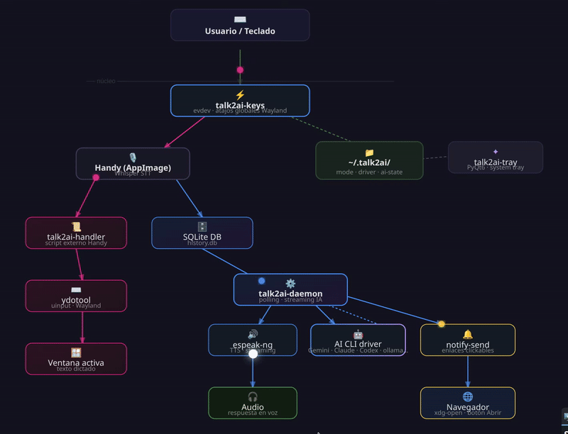

# talk2ai


[](https://handy.computer)
[](https://github.com/espeak-ng/espeak-ng)
[](https://huggingface.co/hexgrad/Kokoro-82M)
[](https://github.com/OHF-Voice/piper1-gpl)
[](https://antigravity.google)


Asistente de voz para Linux con dos modos de uso: **dictado** (tu voz → texto en la ventana activa) e **IA** (tu voz → respuesta de la IA → audio). Usa [Handy](https://handy.computer) para la transcripción local voz→texto.

```
🎤 Hablas
  ├─ [modo dictado] → ⌨️  texto en la ventana activa
  └─ [modo IA]      → 🤖 IA responde → 🔊 escuchas
```

## Demo



## Modos de uso

| Modo | Atajo | Qué hace |
|---|---|---|
| **Dictado** | `Alt+Super+H` | Transcribe tu voz e inyecta el texto en la ventana con foco |
| **IA** | `Alt+Super+G` | Envía tu voz al driver de IA activo y reproduce la respuesta en audio |

El modo persiste hasta que lo cambias. Puedes alternar entre ambos en cualquier momento.

## Componentes

| Componente | Función | Privacidad |
|---|---|---|
| [**Handy**](https://handy.computer) | Transcripción voz→texto (Whisper local) | 100 % local |
| **Driver de IA** (IA CLI) | Procesamiento de la consulta | Requiere internet |
| **TTS** | eSpeak-ng Retro; Kokoro opcional con descarga verificada | 100 % local |
| **ydotool / xdotool** | Inyección de texto en la ventana activa (Wayland/X11) | 100 % local |
| **talk2ai-daemon** | Supervisor, polling IA, keepalive de atajos | — |
| **talk2ai-handler** | Script externo de Handy para modo dictado | — |
| **talk2ai-tray** | Icono de bandeja del sistema (PyQt6) | — |
| **talk2ai-keys** | Atajos globales via evdev en Wayland | — |
| **talk2ai-control** | Menú interactivo (kdialog) para gestionar el servicio | — |

## Características

- **Dos modos** — dictado directo en cualquier app o consulta a la IA, con un atajo cada uno
- **Transcripción local** — Handy usa Whisper en local; tu voz no sale del equipo
- **Driver extensible** — cada archivo en `~/.talk2ai/ia/<nombre>` es un driver intercambiable
- **Rápido** — el handler sale en <100 ms para no bloquear Handy; la IA responde en streaming
- **Tray icon** — muestra el modo activo y el estado del sistema en tiempo real
- **Wayland y X11** — `ydotool` en Wayland, `xdotool` en X11
- **Autostart** — servicio systemd + desktop entry para arrancar con la sesión

> **Nota:** en modo IA la consulta viaja a los servidores del proveedor del driver activo (a menos que uses un driver local como Ollama). El audio se sintetiza localmente: eSpeak-ng Retro es el valor por defecto y fallback. Kokoro permanece no seleccionable hasta completar validación real de runtime, voces españolas y reproducción.

## Voz / TTS

La elección de voz es independiente del driver y modelo de IA. El menú del
tray **Voz / TTS** permite seleccionar un perfil del catálogo y reproducir una
frase fija sin consultar al LLM. Las preferencias se guardan en
`$TALK2AI_DIR/tts-engine`, `tts-voice` y `tts-speed`. En instalaciones nuevas
`TALK2AI_DIR` usa `${XDG_STATE_HOME:-~/.local/state}/talk2ai`; si ya existe
`~/.talk2ai`, se conserva por compatibilidad. Se puede fijar explícitamente
con `TALK2AI_DIR=/ruta/talk2ai`.

eSpeak-ng Retro (`es`, velocidad 140, tono 40) funciona sin modelos y es el
fallback. El manifiesto permite descargar conscientemente y con SHA-256 los
artefactos Kokoro, pero las voces `ef_dora`, `em_alex` y `em_santa` **no se
anuncian como disponibles ni se pueden seleccionar** hasta una validación real:

```bash
talk2ai-tts download kokoro-ef-dora --confirm
talk2ai-tts list
```

El catálogo no instala ni descarga modelos durante `install.sh`. Sus archivos
versionados se despliegan y actualizan en `${TALK2AI_DATA_DIR:-${XDG_DATA_HOME:-~/.local/share}/talk2ai}`;
las preferencias y el estado existentes permanecen en `$TALK2AI_DIR`. Piper y sus
voces permanecen visibles sólo como bloqueadas: no se activan ni descargan.
El runtime Python de Kokoro se mantiene en `$TALK2AI_DIR/tts-venv`; su instalación
automática sigue bloqueada hasta publicar un lock transitorio por plataforma
que incluya `misaki` y todas sus dependencias, con hashes y avisos revisados.
La velocidad se elige desde el tray y se guarda
por usuario; eSpeak usa palabras por minuto y Kokoro multiplicadores, sin
mezclar unidades.

## Requisitos

- **SO:** Linux x86_64 (KDE Plasma recomendado; otros escritorios soportados)
- **Python:** 3.10–3.13 (versiones verificadas en CI)
- [**Handy**](https://handy.computer) AppImage en PATH como `handy`
- [**Antigravity AGY / Gemini CLI**](https://antigravity.google) en PATH y autenticado (`agy` o `gemini`) (driver por defecto, modelo `gemini-3.8-flash-low`)

## Instalación

### Paso previo: instalar Handy y Gemini / AGY CLI

**1. Handy** — descarga la última versión desde [github.com/cjpais/Handy/releases](https://github.com/cjpais/Handy/releases) y colócalo en PATH:

```bash
chmod +x Handy_*.AppImage
mv Handy_*.AppImage ~/.local/bin/handy
```

**2. Antigravity AGY / Gemini CLI** — driver de IA por defecto con `gemini-3.8-flash-low`. Requiere tener `agy` (Antigravity CLI) o `gemini` en PATH y autenticado:

```bash
# Antigravity AGY CLI (recomendado):
agy -p "hola" --model gemini-3.8-flash-low

# O Gemini CLI (fallback):
npm install -g @google/gemini-cli
gemini auth login
```

> Puedes usar cualquier otro driver compatible (Claude, Ollama, etc.) siguiendo el [contrato de driver](#drivers-de-ia).

### Instalar talk2ai

```bash
git clone https://github.com/GOTXE/talk2ai.git
cd talk2ai
bash install.sh
```

El instalador se encarga de todo: dependencias del sistema, scripts, servicio systemd, autostart, **configuración de Handy** y arranque del tray.

### Configurar Handy manualmente

El instalador configura Handy automáticamente, pero si necesitas revisarlo o hacerlo a mano:

Abre Handy y ajusta lo siguiente:

**Pestaña General — Shortcut**

Asigna un atajo de grabación que **no** entre en conflicto con los atajos de talk2ai. Los atajos reservados son:

| Atajo | Reservado por |
|---|---|
| `Ctrl+Space` | talk2ai (PTT gestionado por talk2ai-keys) |
| `Alt+Super+G` | talk2ai (modo IA) |
| `Alt+Super+H` | talk2ai (modo Dictado) |
| `Ctrl+Alt+Q` | talk2ai (detener audio) |

> Recomendado: deja el atajo interno de Handy **desactivado** — talk2ai gestiona `Ctrl+Space` directamente vía evdev para evitar doble disparo.

**Pestaña Avanzado — Paste method**

Selecciona **External script** e introduce la ruta:

```
/home/TU_USUARIO/.local/bin/talk2ai-handler
```

**Modelos**

Descarga **Parakeet v3** (transcripción offline en español e inglés, rápido y ligero). En Handy → Models → Parakeet v3 → Download.

## Atajos de teclado

| Atajo | Acción |
|---|---|
| `Alt+Super+G` | Cambiar a modo IA |
| `Alt+Super+H` | Cambiar a modo Dictado |
| `Ctrl+Space` | Toggle grabación (1ª pulsación = grabar, 2ª = transcribir) |
| `Ctrl+Alt+Q` | Detener síntesis, reproducción y cola TTS inmediatamente |

## Estructura del repositorio

```
talk2ai/
├── scripts/
│   ├── talk2ai-daemon    ← supervisor + polling IA
│   ├── talk2ai-handler   ← script externo de Handy (modo dictado)
│   ├── talk2ai-tray      ← tray icon PyQt6
│   ├── talk2ai-keys      ← atajos globales evdev (Wayland)
│   └── talk2ai-control   ← menú kdialog
├── config/
│   ├── talk2ai.service      ← servicio systemd
│   ├── talk2ai-tray.desktop ← autostart KDE
│   ├── xbindkeysrc          ← atajos para X11
│   ├── voice-prompt.md      ← instrucciones TTS para el driver
│   ├── gemini-context.md    ← personalidad/contexto de Gemini
│   └── ia/
│       └── gemini           ← driver Gemini / AGY CLI
└── docs/
    └── ARQUITECTURA.md
```

## Gestión del servicio

```bash
systemctl --user start|stop|restart|status talk2ai.service
journalctl --user -u talk2ai.service -f   # logs en tiempo real
talk2ai-control                           # menú interactivo
```

## Drivers de IA

El sistema usa un contrato simple: cada archivo ejecutable en `~/.talk2ai/ia/<nombre>` es un driver.

- **Entrada:** prompt como `$1`
- **Entorno:** `TALK2AI_MODEL`, `TALK2AI_VOICE_PROMPT`, `TALK2AI_CONTEXT_FILE`
- **Salida:** texto en streaming por stdout (sin markdown)
- **Exit:** `0` = éxito, distinto de `0` = error

El driver activo se selecciona desde el tray icon o editando `~/.talk2ai/driver`.

## Diagnóstico rápido

```bash
cat ~/.talk2ai/mode       # ai | dictate
cat ~/.talk2ai/driver     # nombre del driver activo
cat ~/.talk2ai/ai-state   # idle | processing
cat ~/.talk2ai/errors.log # errores recientes

# Probar el driver activo directamente (ejemplo con el driver por defecto)
DRIVER=$(cat ~/.talk2ai/driver)
TALK2AI_MODEL=$(cat ~/.talk2ai/model) \
TALK2AI_VOICE_PROMPT=~/.talk2ai/voice-prompt.md \
TALK2AI_CONTEXT_FILE=~/.talk2ai/context/$DRIVER.md \
~/.talk2ai/ia/$DRIVER "pregunta de prueba"

espeak-ng "prueba"        # verificar audio
```

## Reconocimientos

- [**Handy**](https://handy.computer) de [CJ Pais](https://github.com/cjpais) — transcripción voz→texto local. Distribuido bajo [licencia MIT](https://github.com/cjpais/Handy/blob/main/LICENSE).

## Componentes externos, licencias y atribuciones

Consulta [THIRD_PARTY_NOTICES.md](THIRD_PARTY_NOTICES.md) para el inventario,
estado de aprobación, procedencia, hashes y obligaciones de cada motor, voz,
dependencia e imagen. Los badges no son una concesión de marcas ni sustituyen
los avisos de licencia.

## Licencia

GPL-3.0 — ver [LICENSE](LICENSE).

---

Hecho con ❤️ por [GOTXE](https://github.com/GOTXE) e IA
